# IAM-HomeLab-Portfolio - Hands-On Architecture and Implementation

**Author:** Sanjeev Shrestha | Dallas–Fort Worth Area, TX (Shrestha Technologies)  
**Target Roles:** IAM Engineer / Identity Engineer / Entra ID Engineer / Okta Administrator (2027)  
**Certification Focus:** Preparing for Microsoft SC-300: Identity and Access Administrator Associate  
**Environment:** Microsoft Active Directory/Entra ID

## 6 Labs Architecture Overview
 

## Quick Navigation and Lab Execution Status

| Lab       | Focus Area                                | Status    | Jump to Lab                                                                  |
|-----------|-------------------------------------------|-----------|------------------------------------------------------------------------------|
| **Lab 1** | AD Foundation | Completed | [Go to Lab 1](#lab-1-okta-tenant-setup--configuration)                       |
| **Lab 2** | RBAC | Completed | [Go to Lab 2](#lab-2-active-directory-integration--delegated-authentication) |
| **Lab 3** | Offboarding | Completed | [Go to Lab 3](#lab-3-rbac-design--access-sprawl-investigation)               |
| **Lab 4** | Lockout  | Completed | [Go to Lab 4](#lab-4-saml-20-application-integration)                        |
| **Lab 5** | Entra Connect  | Completed | [Go to Lab 5](#lab-5-adaptive-mfa-step-up-authentication--zero-trust)        |
| **Lab 6** | Conditional Access  | Completed | [Go to Lab 6](#lab-6-okta-jml-lifecycle-automation)                          |

---
## Executive Summary and Business Impact

Implemented an end-to-end IAM environment using Okta, Active Directory, SAML federation, Adaptive MFA, RBAC, and automated Joiner-Mover-Leaver lifecycle processes across six hands-on labs.

* **Tenant Foundation (Lab 1):** Core Okta tenant `*.okta.com - redacted`, custom profile attributes, Groups RBAC, Global Session + Auth + Enrollment Policies.
* **Access Governance (Lab 3+4):** Group-based provisioning, access-sprawl audit via System Log `application.user_membership.add`, least-privilege via group app assignments for Slack, Workspace, SharePoint.
* **Lifecycle Automation (Lab 2+6):** AD `allenlab.local` as source with DelAuth + Full/Incremental Import via AD Agent, JML automation with PowerShell + CSV batch `jml-batch.csv`, Unassigned → Confirm → Active/Deactivated.
* **Centralized Auth (Lab 4):** SAML 2.0 federation with attribute mapping across Slack, Google Workspace, SharePoint.
* **Zero Trust (Lab 5):** Network Zones Trusted/Untrusted IP, Adaptive Sign-On + Step-Up High Assurance for SharePoint, Passwordless Okta Verify Push with Number Matching.
* **Users Managed:** 20+ AD users, 6 Groups, 3 SAML Apps, 22 MFA policies

---

## Key Skills Demonstrated

* Okta Tenant Administration & Profile Editor
* Active Directory (AD) Integration & Delegated Authentication
* Role-Based Access Control (RBAC) Design
* SAML 2.0 SSO Federation & Attribute Mapping
* Adaptive Risk-Based Authentication & Network Zones
* Step-Up Authentication & Passwordless Policies
* User Lifecycle Management (JML) & Access Sprawl Audit

## Detailed Lab Implementations and Visual Proof

### Lab 1: AD Foundation

**Key Learnings and Takeaways:**
* Plan for leavers, not just joiners Disabled accounts need their own OU. It keeps terminated users isolated, easy to audit, and out of sync.
* Give access to groups, not people When access lives in groups, moves and exits become a membership change, not a cleanup project.
* Don't sync everything to the cloud If an account shouldn't have access, it shouldn't sync to Entra ID either.

📸 <b>click here to view Lab 1 Diagrams and Screenshots</b>

 

#### Architecture Diagram
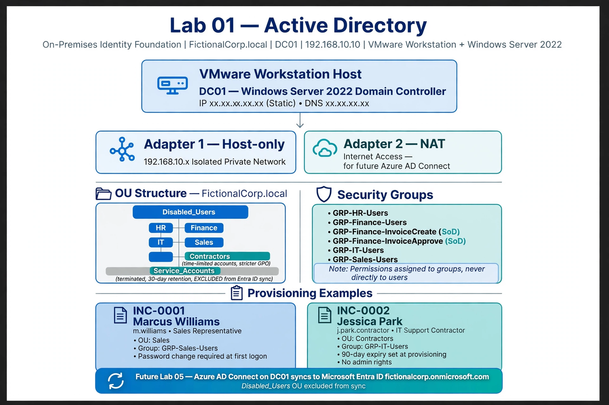

#### AD Foundation
* **Environment:**  
  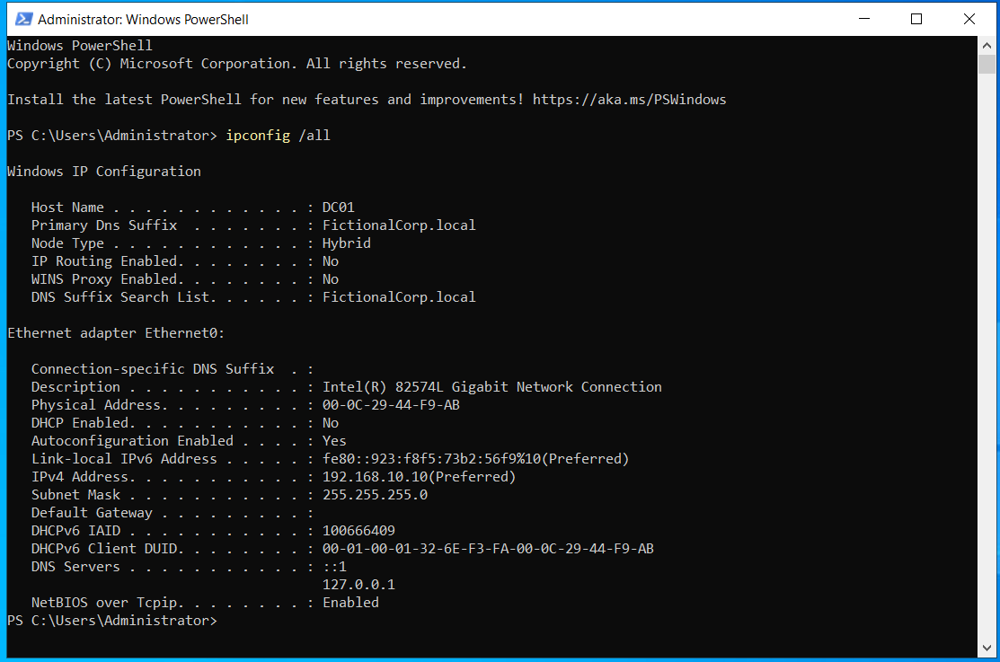
* **ADUC OU Tree:**  
  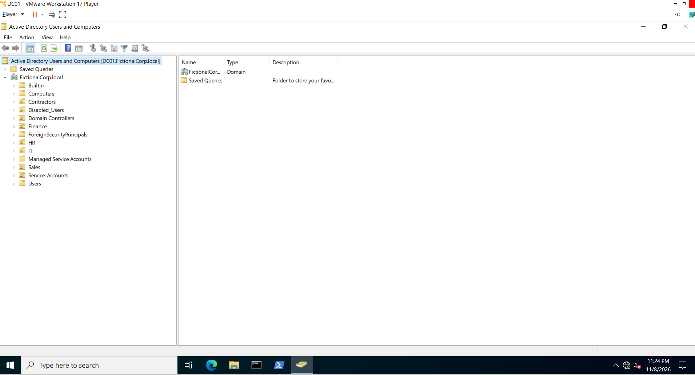
* **Groups-Finance-SoD:**  
  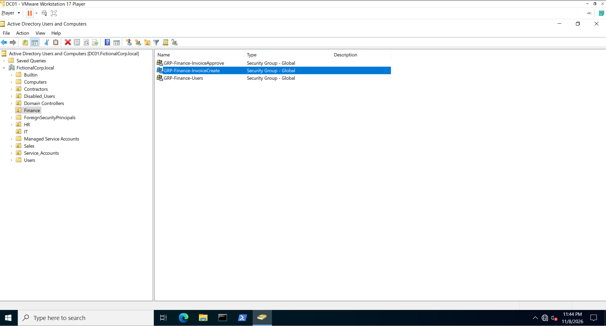
* **Marcus-Williams:**  
  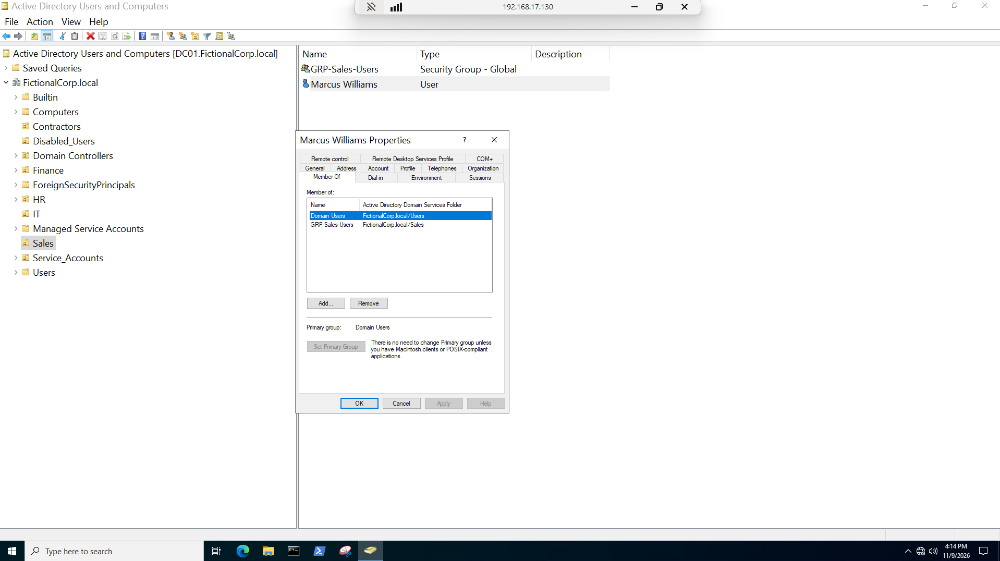
* **Jessica-Park:**  
  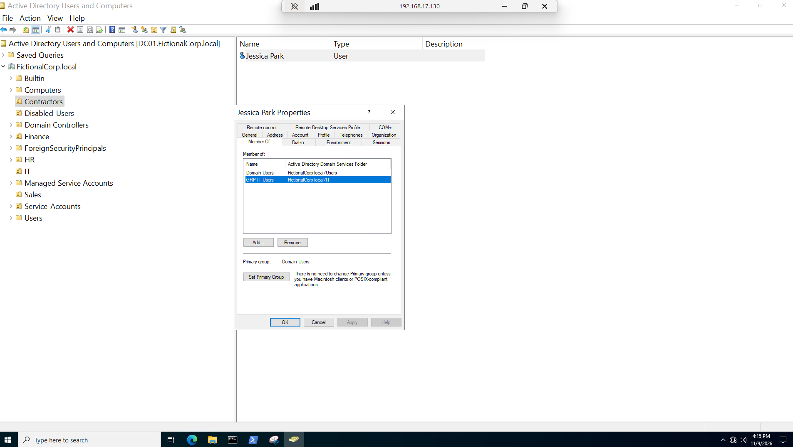
* **Jessica-Park-Expiry:**  
  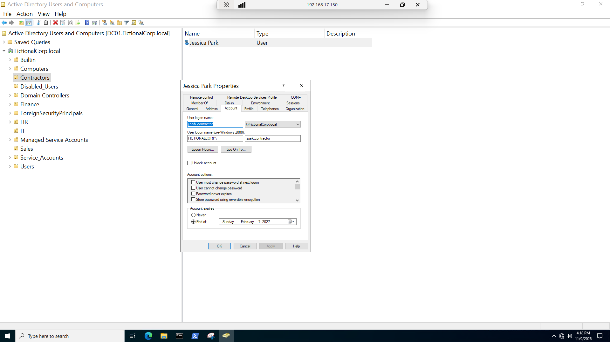

---
**[↑ Back to Lab Execution Status](#lab-execution-status)**

### Lab 2: RBAC

**Key Learnings and Takeaways:**
* Design before you build - If it's not in the matrix, don't build it. If you built it but it's not in the matrix, that's an audit finding.
* The matrix is the contract - Map each role to systems like — AD, Email, FinanceCore, PeopleHub, SalesPro, — plus Invoice Create / Approve / Admin. Every cell gets Allow, Deny, or Read-Only.
* SoD stops fraud, not just paperwork - Define the conflicts before we build.

📸 <b>click here to view Lab 2 Diagrams and Screenshots</b>

 

#### Architecture Diagram
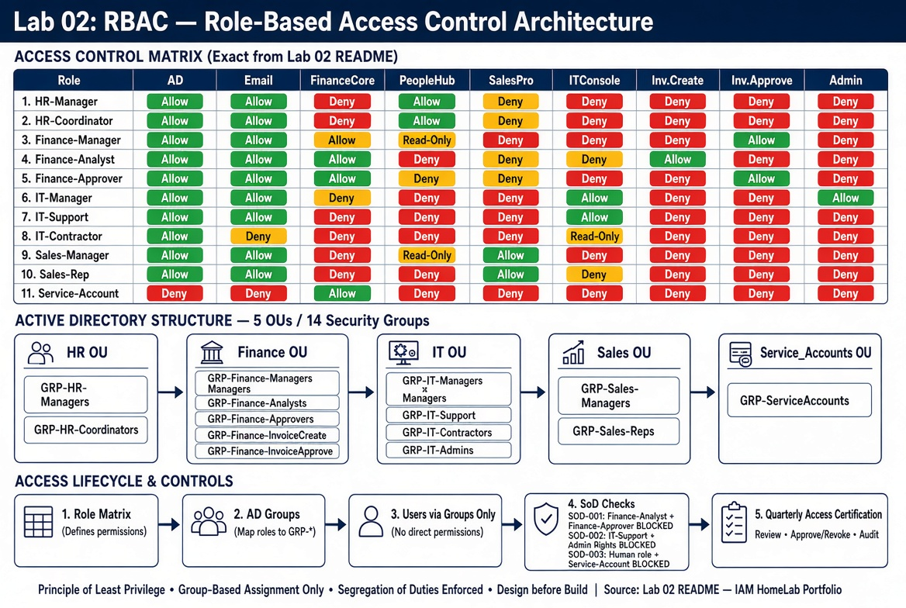

#### RBAC Proof
* **SoD Policy:**  
  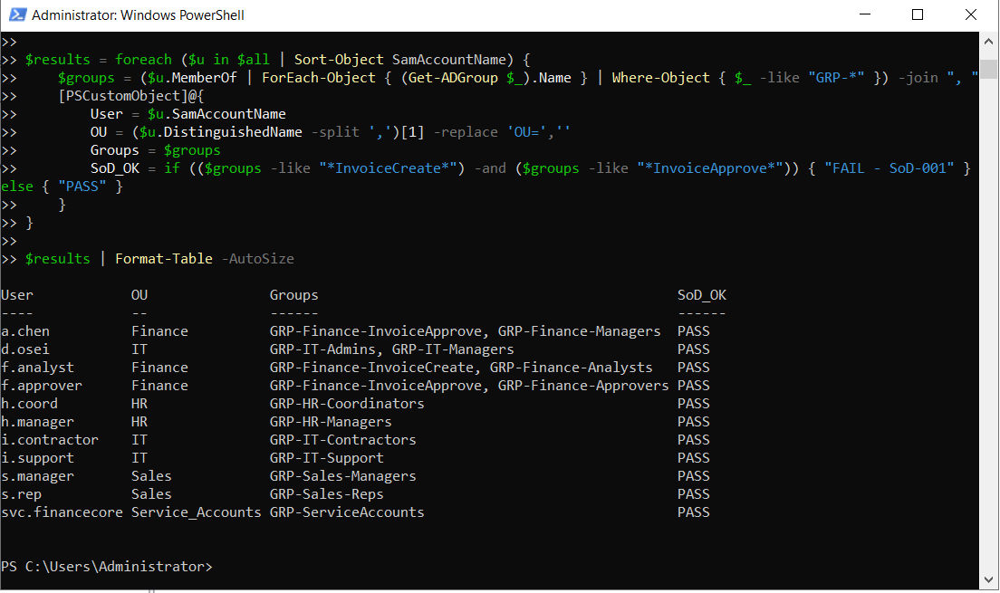
* **Privilege Creep - Before remediation :**  
  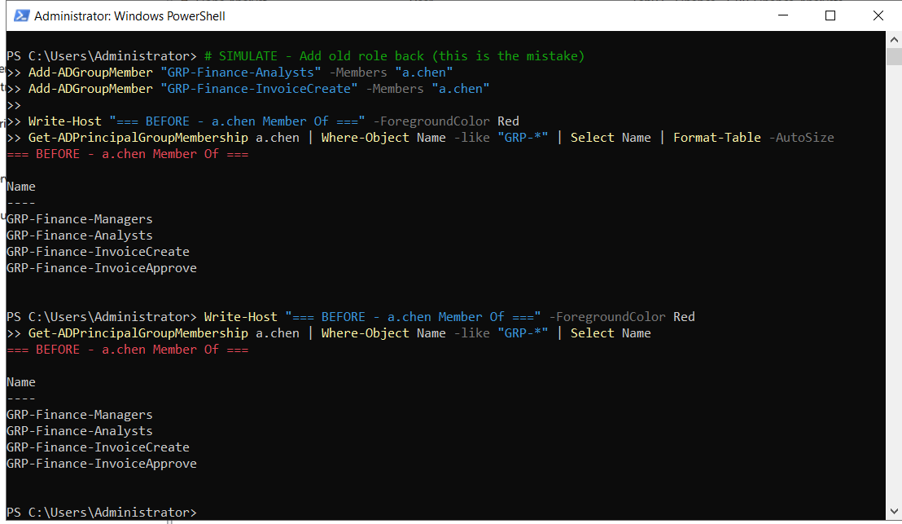
* **After remediation:**  
  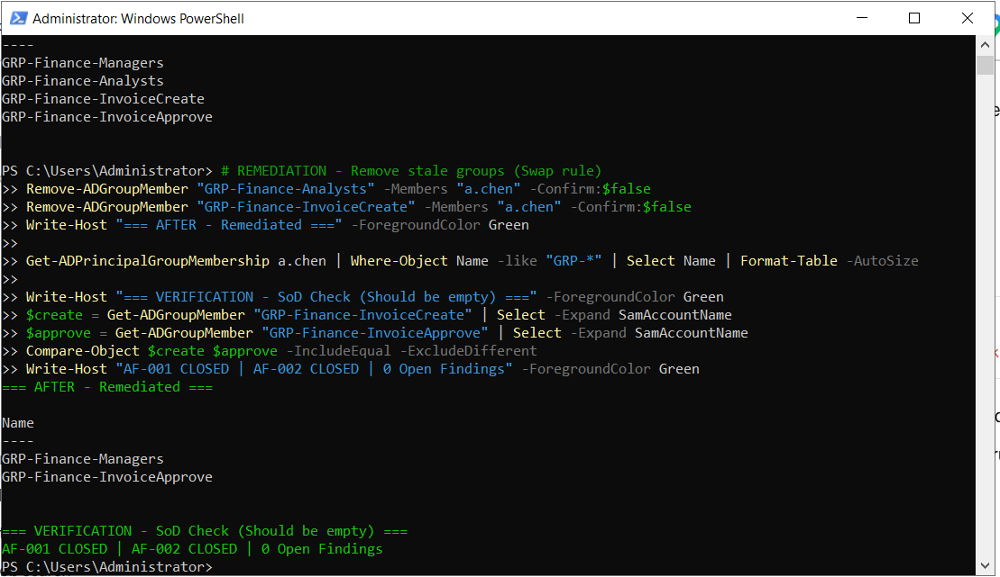
* **Role Change:**  
  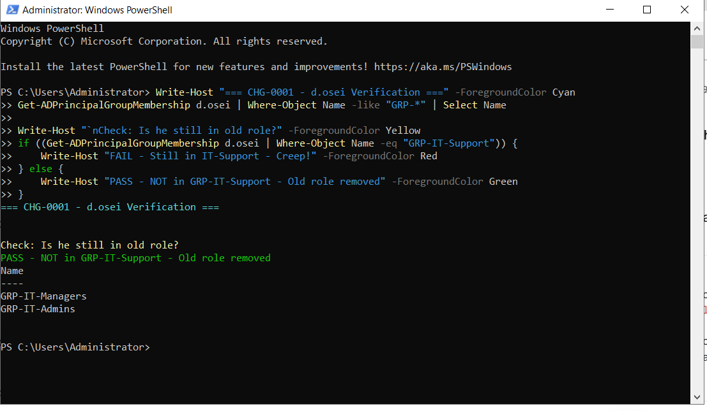
* **Access Certification:**  
  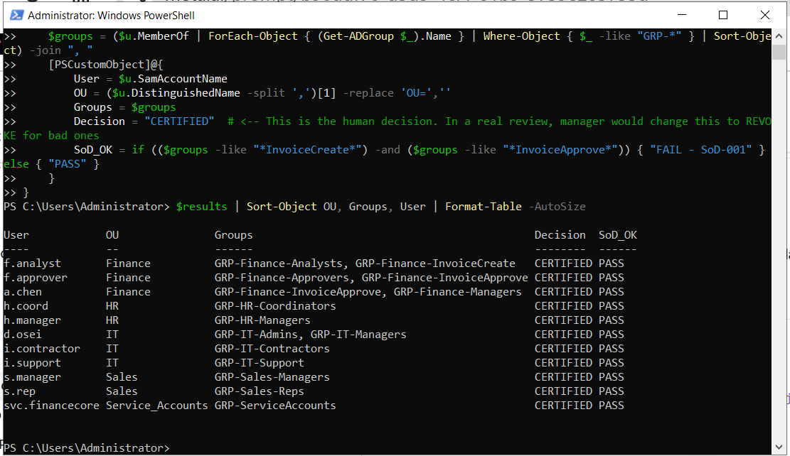
* **Threat Connections:**  
  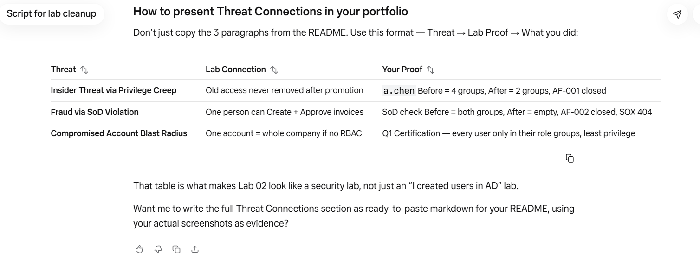
  

---
**[↑ Back to Lab Execution Status](#lab-execution-status)**

### Lab 3: RBAC Design and Access Sprawl Investigation

**Key Learnings and Takeaways:**
* Enforced end-to-end lifecycle flow: `HR → AD → Okta`. Tested AD account disablement and verified the resulting Okta lifecycle state. Session revocation and downstream application access require separate validation.
* Audited governance bypasses in Okta System Logs (`application.user_membership.add`) to detect direct user-to-app assignments and restore strict RBAC posture.

📸 <b>click here to view Lab 3 Diagrams and Screenshots</b>

 

#### Architecture Diagram

#### RBAC & Deprovisioning Proof
* **Group Sync Verification:**  
  
* **Full Reconciliation Import:**  
  
* **Lifecycle Deactivation (AD side):**  
  
* **Lifecycle Deactivation (Okta side):**  
  
* **Access Sprawl Investigation and Audit Report:**  
    
  

---
**[↑ Back to Lab Execution Status](#lab-execution-status)**

### Lab 4: SAML 2.0 Application Integration

**Key Learnings and Takeaways:**
* Configured custom SAML 2.0 integrations with multiple Service Providers (Slack, Google Workspace, SharePoint).
* Applied least-privilege entitlements through group memberships rather than direct assignments. Verified user access segregation across distinct user profiles in Incognito test sessions.

📸 <b>click here to view Lab 4 Diagrams and Screenshots</b>

 

#### Architecture Diagram

#### SAML Integration Proof
* **Custom SAML Configuration:**  
    
    
  
* **Group-Based Application Assignments:**  
    
  
* **Least Privilege Access Verification:**  
  * *Finance User (John Smith - Limited Access):*  
    
  * *HR & Cloud Admin (Lisa Park - Extended Access):*  
    

---
**[↑ Back to Lab Execution Status](#lab-execution-status)**

### Lab 5: Adaptive MFA, Step-Up Authentication and Zero Trust

**Key Learnings and Takeaways:**
* Defined trusted vs. untrusted IP Network Zones. Constructed Adaptive Sign-On Rules to require MFA or block access based on client network context.
* Enforced step-up authentication policies on high-value resources (e.g., SharePoint) to challenge active sessions upon accessing sensitive data.

📸 <b>click here to view Lab 5 Diagrams and Screenshots</b>

 

#### Architecture Diagram

#### MFA & Policy Verification
* **Authenticator Enrollment & Passwordless Setup:**  
    
  
* **Network Zones & Adaptive Rules:**  
    
    
  
* **Step-Up Authentication Engine:**  
    
    
  
* **User Authentication Testing:**  
    
  

---
**[↑ Back to Lab Execution Status](#lab-execution-status)**

### Lab 6: Okta JML Lifecycle Automation

**Key Learnings & Takeaways:**
- Automates Joiner, Mover, and Leaver lifecycle actions using PowerShell and Active Directory.
- Uses the Okta AD Agent and Full/Incremental Import to validate applicable AD changes in Okta.
- Supports CSV-driven batch processing for multiple lifecycle actions.

📸 <b>click here to view Lab 6 Diagrams and Screenshots</b>

 

#### Architecture Diagram

#### Joiner Mover Leaver Lifecycle
* **Joiner Onboarding Script:**  
      
* **IT Confirmation:**  
    
* **Mover Script:**  
      
* **Finance Confirmation:**  
  
* **Leaver Script:**  
  
* **Deactivation Confirmation:**  
  
* **CSV Driven Batch Processing:**  
  
* **Activated Deactivated Confirmation:** 
  
* **HR Group Confirmation:** 
  
* **Finance Group Confirmation:** 
  

---
#### 📂 Code & Automation Artifacts (Direct Inspect)
- **Joiner:** [`scripts/Joiner.ps1`](scripts/Joiner.ps1) — Create a user and assign configured groups.
- **Mover:** [`scripts/Mover.ps1`](scripts/Mover.ps1) — Update user attributes and change group memberships.
- **Leaver:** [`scripts/Leaver.ps1`](scripts/Leaver.ps1) — Disable the account and remove configured group memberships.
- **CSV input:** [`csv-file/Jml-Batch.csv`](csv-file/Jml-Batch.csv) — Batch lifecycle records.
- **Batch runner:** [`scripts/JML-Batch.ps1`](scripts/JML-Batch.ps1) — Process CSV records with validation.

#### Validation and Limitations

AD and Okta state changes do not, by themselves, prove downstream application deprovisioning or active-session revocation. Those outcomes require separate validation.

**[↑ Back to Lab Execution Status](#lab-execution-status)**

---

## Original Repository and Credits
This hands-on lab series was adapted and built upon the foundational framework provided by [RyanKennon/Okta-Lab-Series](https://github.com/RyanKennon/Okta-Lab-Series). Full original references can be found in [REFERENCE.md](REFERENCE.md).

